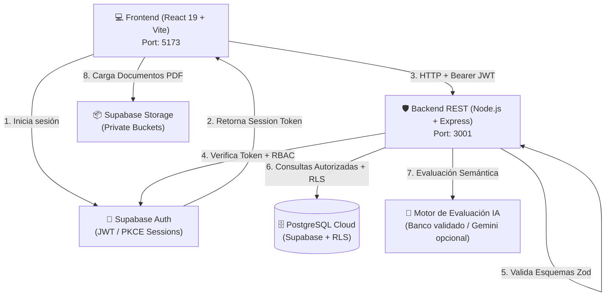

# 🎓 InterAula — Plataforma de Tutorías Universitarias y Aprendizaje Colaborativo

InterAula es una plataforma integral de tutorías universitarias, aprendizaje colaborativo neuroinclusivo (DUA) y acreditación docente entre pares. El sistema opera bajo una arquitectura desacoplada de **Frontend** (React 19 + TypeScript + Vite) y **Backend REST propio** (Node.js + Express + TypeScript + Zod), respaldada por servicios cloud en **PostgreSQL (Supabase)** para persistencia y almacenamiento de archivos privados.

**Estado del 7 de noviembre de 2026:** las correcciones están implementadas y probadas localmente. Su activación remota requiere verificar el historial de la base, aplicar las migraciones 016 y 017 y configurar la clave administrativa exclusivamente en el backend. Las migraciones no se han aplicado al proyecto remoto durante esta revisión. Consulta [correcciones, activación y recomendaciones por intereses](docs/CORRECCIONES_Y_RECOMENDACIONES.md) antes de desplegar.

**9 de noviembre:** implementados **Perfil → Mis intereses** y **Para ti** en el portal, con selección por cuenta, recomendaciones explicadas, ocultar/deshacer y personalización opcional. Requiere la migración 018; el clustering queda para la siguiente fase. [Uso, activación y validación](docs/INTERESES_Y_PARA_TI.md).

**Activación confirmada:** el usuario ejecutó las migraciones 016–018 mediante el archivo único. La API devuelve 22 temas y permite consultar talleres. Los contenedores están saludables; abrir http://localhost, iniciar sesión y elegir temas en **Perfil → Mis intereses**. La configuración privada de acreditación automática sigue siendo un paso separado.

**Datos de demostración:** [carga SQL, retiro y matriz de pruebas para los 22 intereses](docs/PRUEBAS_RECOMENDACIONES.md). Los archivos DEMO son opcionales y no se ejecutan automáticamente con Docker ni con las migraciones.

**Buscador global:** la barra superior permite encontrar módulos y opciones con **Ctrl + K**, incluyendo «Quiero aprender», «Borradores» y «Mis postulaciones». [Uso y alcance](docs/BUSCADOR_GLOBAL.md).

---

## 🏛️ 1. Arquitectura del Sistema



### Tabla de Responsabilidades por Capa

| Capa | Tecnologías | Responsabilidades Clave |
| :--- | :--- | :--- |
| **Frontend** | React 19, TypeScript, Vite, CSS | - Presentación visual, navegación y experiencia accesible (DUA / neuroinclusiva).<br/>- Formularios y validaciones inmediatas de UX.<br/>- Cliente HTTP centralizado (`apiClient.ts`) con inyección automática de Bearer Token.<br/>- Sin claves privadas ni decisiones administrativas basadas exclusivamente en el cliente. |
| **Backend Propio** | Node.js, Express, TypeScript, Zod | - API REST modular con prefijo `/api` y endpoint de salud `/api/health`.<br/>- Verificación criptográfica oficial de sesiones Supabase Auth.<br/>- Autorización estricta por rol, pertenencia de recurso y permisos.<br/>- Protección contra asignación masiva de campos (*anti-mass assignment*).<br/>- Reglas de negocio críticas (umbral de bot >= 70%, anti-solapamiento, anti-autotutoría).<br/>- Registro de auditoría no sensible y manejo centralizado de errores HTTP. |
| **Supabase Cloud** | PostgreSQL, Auth, Storage | - Base de datos PostgreSQL en la nube.<br/>- Políticas de seguridad a nivel de fila (RLS) como defensa en profundidad.<br/>- Gestión de identidades y ciclo de vida de tokens de autenticación.<br/>- Almacenamiento seguro de evidencias y certificados académicos privados. |

---

## 2. Estructura del Proyecto

```text
InterAula/
├── frontend/                      # Aplicación cliente (React 19 + TypeScript + Vite)
│   ├── public/                    # Activos estáticos públicos
│   ├── src/
│   │   ├── components/            # Componentes comunes, layout y sistema de iconos SVG
│   │   ├── constants/             # Endpoints REST y reglas de negocio centralizadas
│   │   ├── context/               # AuthContext y CalmModeContext (ajustes de accesibilidad)
│   │   ├── lib/                   # Cliente HTTP (apiClient.ts) y cliente Supabase
│   │   ├── pages/                 # Vistas (Home, LearningSpace, Dashboard, Tutoring, Projects, Forum, etc.)
│   │   ├── router/                # Enrutamiento SPA con carga diferida (AppRouter.tsx)
│   │   ├── services/              # Servicios del frontend (learningSpace, tutoring, projects, notes, etc.)
│   │   ├── styles/                # Hojas de estilo modulares (home.css, dashboard.css)
│   │   └── types/                 # Definiciones de tipos TypeScript
│   ├── tests/                     # Pruebas automatizadas del frontend
│   ├── Dockerfile                 # Construcción multi-stage con Nginx
│   ├── nginx.conf                 # Configuración SPA + proxy inverso /api
│   ├── package.json
│   └── vite.config.ts
├── backend/                       # Backend REST propio en Node.js + Express
│   ├── src/
│   │   ├── config/                # Carga y validación de variables de entorno
│   │   ├── controllers/           # Controladores HTTP (incluye learningSpace.controller.ts)
│   │   ├── lib/                   # Clientes Supabase; persistentStore solo para pruebas
│   │   ├── middlewares/           # Middlewares (requireAuth, validateRequest, errorHandler)
│   │   ├── routes/                # Enrutadores modulares (/learning-space, /profiles, /tutoring, /projects, etc.)
│   │   ├── schemas/               # Esquemas de validación estricta con Zod
│   │   ├── services/              # Lógica de negocio y motor de explicaciones adaptables
│   │   ├── tests/                 # Suite de pruebas automatizadas de la API
│   │   ├── app.ts                 # Configuración de Express, CORS, Helmet y rutas
│   │   └── server.ts              # Inicio del servidor HTTP y graceful shutdown
│   ├── Dockerfile                 # Construcción de contenedor del backend
│   ├── package.json
│   └── tsconfig.json
├── supabase/
│   └── migrations/                # Historial SQL y políticas RLS (001 a 018; revisar antes de aplicar)
├── docker-compose.yml             # Orquestación de contenedores frontend y backend
├── docker-start.bat               # Inicio con Docker Compose desde la ubicación del proyecto
├── docker-stop.bat                # Script de detención limpia
├── .env.example                   # Plantilla de variables de entorno
└── package.json                   # Scripts orquestadores en la raíz
```

---

## ⚙️ 3. Requisitos y Configuración de Entorno

### Requisitos Previos
- **Node.js**: v20.x o superior (comprobado localmente con v22.17.0)
- **npm**: v10.x o superior

### 1. Variables de Entorno del Frontend (`.env` en la raíz)
Copiar `.env.example` a `.env.local` o `.env`:
```bash
cp .env.example .env
```
Contenido requerido:
```ini
# URL del backend REST propio
VITE_API_URL=http://localhost:3001/api

# Conexión cliente a Supabase Cloud
VITE_SUPABASE_URL=https://tu-proyecto.supabase.co
VITE_SUPABASE_PUBLISHABLE_KEY=tu-clave-anonima-publica
```

### 2. Variables de Entorno del Backend (`backend/.env`)
Copiar `backend/.env.example` a `backend/.env`:
```bash
cp backend/.env.example backend/.env
```
Contenido requerido:
```ini
PORT=3001
NODE_ENV=development
CORS_ORIGIN=http://localhost:5173,http://localhost:3000

SUPABASE_URL=https://tu-proyecto.supabase.co
SUPABASE_ANON_KEY=tu-clave-anonima-publica
SUPABASE_SERVICE_ROLE_KEY=

# Opcional para habilitar IA de Google Gemini en el servidor
GEMINI_API_KEY=
```

---

## 🚀 4. Ejecución en Entorno Local

Puedes iniciar los servicios de forma individual o conjunta:

Instala primero las dependencias con `npm ci --prefix frontend` y `npm ci --prefix backend`. La acreditación automática necesita `SUPABASE_SERVICE_ROLE_KEY` solo en `backend/.env`; no se usa la clave pública como sustituto administrativo. Sin Gemini, las respuestas abiertas se presentan como no evaluadas. El banco determinista solo habilita asignaturas con al menos cinco preguntas y acredita el nivel básico.

### Iniciar el Backend REST
```bash
npm run dev:backend
# o desde la carpeta backend:
cd backend && npm run dev
```
*El backend iniciará en `http://localhost:3001` (Health Check: `http://localhost:3001/api/health`).*

### Iniciar el Frontend Vite
```bash
npm run dev
```
*La interfaz estará disponible en `http://localhost:5173`.*

---

## 🧪 5. Ejecución de Pruebas Automatizadas

El proyecto cuenta con suites de pruebas automatizadas que verifican autenticación, validación Zod, reglas de negocio, antifraude y control de acceso.

```bash
# Ejecutar todas las pruebas (Frontend + Backend)
npm run test:all

# Ejecutar únicamente pruebas del Backend API
npm run test:backend

# Ejecutar únicamente pruebas del Frontend
npm test

# Verificación de tipos TypeScript en Frontend y Backend
npx tsc --noEmit
npm run build:backend

# Verificación de Linting con Oxlint
npm run lint
```

---

## 📡 6. Catálogo de Endpoints de la API

Todos los endpoints tienen el prefijo `/api`.

### Estado del Sistema
| Método | Ruta | Autenticación | Descripción |
| :--- | :--- | :--- | :--- |
| `GET` | `/health` | Pública | Retorna salud, estado del servicio y uptime sin filtrar secretos. |

### Perfiles (`/profiles`)
| Método | Ruta | Autenticación | Permisos / Reglas |
| :--- | :--- | :--- | :--- |
| `GET` | `/me` | Requerida | Retorna perfil privado del usuario autenticado. |
| `PUT` | `/me` | Requerida | Actualiza perfil propio con validación Zod y protección anti-mass assignment. |
| `GET` | `/catalog/subjects` | Pública | Obtiene listado oficial de asignaturas del catálogo académico. |
| `GET` | `/:id` | Opcional | Retorna perfil público respetando preferencias de privacidad. |
| `GET` | `/:userId/offered-subjects` | Pública | Materias que un tutor ofrece. |
| `POST` | `/offered-subjects` | Requerida | Registra materia ofrecida (fuerza `is_verified = false`). |
| `DELETE` | `/offered-subjects/:subjectId`| Requerida | Elimina materia ofrecida por el usuario autenticado. |
| `GET` | `/:userId/needed-subjects` | Pública | Materias que un estudiante requiere reforzar. |
| `POST` | `/needed-subjects` | Requerida | Registra materia de interés formativo. |
| `DELETE` | `/needed-subjects/:id` | Requerida | El parámetro es el UUID de la asignatura; elimina la relación del usuario autenticado. |

### Tutorías Individuales (`/tutoring`)
| Método | Ruta | Autenticación | Permisos / Reglas |
| :--- | :--- | :--- | :--- |
| `GET` | `/tutors` | Pública | Explorar tutores disponibles con filtros y materias ofrecidas. |
| `GET` | `/my-sessions` | Requerida | Obtener sesiones del usuario con rol `student` o `tutor`. |
| `POST` | `/sessions` | Requerida | Solicitar tutoría. Valida anti-solapamiento y prohíbe auto-tutoría. |
| `PATCH`| `/sessions/:id/status` | Requerida | Transición de estado (`accepted`, `rejected`, `completed`, `cancelled`). |
| `POST` | `/sessions/:id/reviews` | Requerida | Calificar sesión completada (escala 1 a 5 con desglose cualitativo). |
| `POST` | `/sessions/attendance` | Requerida | Registro de asistencia y permanencia en sala de clase virtual. |

### Talleres Grupales (`/workshops`)
| Método | Ruta | Autenticación | Permisos / Reglas |
| :--- | :--- | :--- | :--- |
| `GET` | `/` | Opcional | Lista de talleres próximos o en curso con estado de inscripción. |
| `GET` | `/:id` | Opcional | Detalle de taller por UUID o código amigable de sala (`room_id`). |
| `POST` | `/` | Requerida | Crear taller grupal (fuerza `tutor_id = user.id`, cupo mínimo 2). |
| `POST` | `/:id/enroll` | Requerida | Inscripción de estudiante con control estricto de cupo y anti-dueño. |
| `DELETE`| `/:id/enroll` | Requerida | Cancelar inscripción a taller. |
| `PATCH`| `/:id/status` | Requerida | Cambiar estado del taller (solo tutor propietario o administrador). |
| `DELETE`| `/:id` | Requerida | Eliminar taller (solo tutor propietario o administrador). |
| `GET` | `/me/as-student` | Requerida | Talleres donde el estudiante está inscrito. |
| `GET` | `/me/as-tutor` | Requerida | Talleres creados por el tutor autenticado. |

### Acreditación y Validación Docente (`/verification`)
| Método | Ruta | Autenticación | Permisos / Reglas |
| :--- | :--- | :--- | :--- |
| `GET` | `/my-requests` | Requerida | Solicitudes de verificación del postulante autenticado. |
| `GET` | `/for-validator` | Requerida | Panel docente (exclusivo para validador académico o admin). |
| `POST` | `/requests` | Requerida | Crear solicitud formal de acreditación técnica en una asignatura. |
| `POST` | `/attempts` | Requerida | Inicia un intento; conserva las respuestas correctas en el servidor. |
| `POST` | `/attempts/:id/answers` | Requerida | Procesa una respuesta del intento propio y calcula el resultado. |
| `POST` | `/bot-grant` | Requerida | Recibe únicamente `attempt_id`; confirma un intento aprobado con al menos 70%, nivel básico. |
| `POST` | `/endorsements` | Requerida | Registra una solicitud en el panel de un validador registrado; no envía correos. |
| `POST` | `/requests/:id/practical-exercise` | Requerida | Asignar caso práctico (solo docente validador). |
| `POST` | `/requests/:id/practical-submission`| Requerida | Entrega de solución técnica y defensa conceptual del postulante. |
| `POST` | `/requests/:id/review` | Requerida | Dictamen resolutivo (`approved`, `rejected`, `requires_reevaluation`). **Prohíbe auto-evaluación docente**. |
| `POST` | `/requests/:id/certificate` | Requerida | Registrar metadatos y extracción OCR del certificado académico en PDF. |
| `DELETE`| `/requests/:id` | Requerida | Cancelar postulación pendiente. |

### Foro Académico (`/forum`)
| Método | Ruta | Autenticación | Permisos / Reglas |
| :--- | :--- | :--- | :--- |
| `GET` | `/posts` | Pública | Consultar publicaciones por categoría o término de búsqueda. |
| `POST` | `/posts` | Requerida | Publicar consulta (asigna autor verificado por sesión). |
| `POST` | `/posts/:id/upvote` | Requerida | Alternar el voto propio de utilidad mediante una operación transaccional. |
| `PATCH`| `/posts/:id/solved` | Requerida | Marcar pregunta como resuelta (solo autor o moderador). |

### Proyectos Colaborativos (`/projects`)
| Método | Ruta | Autenticación | Permisos / Reglas |
| :--- | :--- | :--- | :--- |
| `GET` | `/` | Pública | Explorar proyectos abiertos en el Hub de Colaboración. |
| `GET` | `/me` | Requerida | Proyectos creados por el usuario en sesión. |
| `GET` | `/my-applications` | Requerida | Postulaciones enviadas por el estudiante. |
| `GET` | `/:id` | Opcional | Detalle de proyecto y sus vacantes. |
| `POST` | `/` | Requerida | Crear proyecto colaborativo con sus vacantes iniciales. |
| `POST` | `/:id/positions/:positionId/apply` | Requerida | Postular a vacante (prohíbe postular al propio proyecto). |
| `PATCH`| `/applications/:id/withdraw` | Requerida | Retirar postulación pendiente. |
| `PATCH`| `/applications/:id/review` | Requerida | Resolver postulación (`accepted`, `rejected` - solo dueño del proyecto). |
| `DELETE`| `/:id` | Requerida | Eliminar proyecto propio. |

### Mi espacio de aprendizaje (`/learning-space`)
| Método | Ruta | Autenticación | Permisos / Reglas |
| :--- | :--- | :--- | :--- |
| `GET` | `/overview` | Requerida | Retorna configuración privada, rutas activas, tareas con subtareas y evaluaciones de temas del estudiante. |
| `PUT` | `/config` | Requerida | Actualiza preferencias del perfil de aprendizaje en 4 categorías estructuradas. |
| `POST` | `/paths` | Requerida | Crea ruta de aprendizaje personalizada y genera sus etapas paso a paso. |
| `PATCH`| `/paths/:pathId/stages/:stageId` | Requerida | Marca o desmarca una etapa y recalcula el progreso porcentual real. |
| `DELETE`| `/paths/:pathId` | Requerida | Elimina una ruta de aprendizaje del propietario. |
| `POST` | `/tasks` | Requerida | Crea una tarea de estudio desglosada en subtareas con intervalos configurables. |
| `PATCH`| `/tasks/:taskId` | Requerida | Actualiza subtareas, intervalos o estado de la tarea (`pending`, `in_progress`, `paused`, `completed`). |
| `DELETE`| `/tasks/:taskId` | Requerida | Elimina una tarea de estudio propia. |
| `POST` | `/assessments` | Requerida | Registra comprobación de comprensión y clasifica dominio del tema (`consolidado`, `en_desarrollo`, `necesita_practicar`). |
| `POST` | `/explain` | Requerida | Genera explicación adaptable ("Aprende a tu manera") en 6 modos (`sencilla`, `paso_a_paso`, `ejemplos`, `visual`, `profunda`, `comprobar`). |

### Inteligencia Artificial Segura (`/ai`)
| Método | Ruta | Autenticación | Permisos / Reglas |
| :--- | :--- | :--- | :--- |
| `POST` | `/evaluate-answer` | Requerida | Evaluación semántica de respuestas abiertas con rúbrica pedagógica, protegiendo secretos de IA en el servidor. |

---

## 🔒 7. Medidas de Seguridad Implementadas

1. **Tokens Criptográficos Seguros**: La identidad del usuario se verifica en cada solicitud mediante `supabase.auth.getUser(token)` oficial, rechazando identificadores inyectados en cabeceras o cuerpos.
2. **Defensa en Profundidad**: El backend crea clientes Supabase con el token del usuario (`getAuthenticatedSupabase(token)`), garantizando que las políticas de seguridad a nivel de fila (RLS) en PostgreSQL se sigan evaluando bajo la identidad real del usuario.
3. **Protección Anti-Mass Assignment**: Los esquemas Zod con modo `.strict()` rechazan campos privilegiados como `is_admin`, `role`, `is_verified` o `id`, impidiendo escalamiento de privilegios.
4. **Reglas de Integridad Académica**:
   - Umbral de acreditación del Bot: mínimo estricto del 70%.
   - Prohibición de auto-tutoría (un usuario no puede agendar sesiones consigo mismo).
   - Prohibición de auto-evaluación docente (un docente validador no puede dictaminar su propia solicitud).
5. **Cabeceras de Seguridad y CORS**: Implementación de `Helmet` para prevenir ataques de Clickjacking y MIME-sniffing, y configuración explícita de orígenes autorizados para CORS.
6. **Manejo de Errores Limpio**: Los errores no exponen nombres de tablas internas, trazas de pila (stack traces) ni claves secretas en ambientes productivos.
7. **Política Estricta Anti-Hardcoding**:
   - **Variables de Entorno Centralizadas**: Puertos, URLs de backend y credenciales públicas se configuran en `.env` (tipadas en `src/config/env.ts` para frontend y `backend/src/config/env.ts` para backend). Claves privadas (como `GEMINI_API_KEY` o `SUPABASE_SERVICE_ROLE_KEY`) nunca se exponen al cliente.
   - **Endpoints Centralizados**: Catálogo único en `src/constants/apiEndpoints.ts` que elimina URLs repetidas y cadenas mágicas.
   - **Reglas de Negocio Centralizadas**: Módulo de dominio en `backend/src/constants/businessRules.ts` y `src/constants/businessRules.ts` (umbrales de aprobación >= 70%, capacidades mínimas/máximas de talleres, límites de duración y miembros de proyectos).
   - **Roles y Permisos**: Las operaciones corregidas verifican identidad, propiedad y roles registrados. Las migraciones antiguas 009 y 010 contienen eliminación de tablas y cambios sobre cuentas concretas; no deben repetirse sobre una base existente sin revisar su historial.
   - **Persistencia de Producción**: Los módulos corregidos usan PostgreSQL y comunican los errores de guardado. El respaldo JSON está limitado a `NODE_ENV=test`; no importa ni sincroniza automáticamente archivos locales anteriores.

Estas medidas requieren las políticas y funciones SQL correspondientes instaladas. Las cuotas de API viven en memoria por proceso; varias réplicas necesitan un contador compartido. Las pruebas con PostgreSQL embebido no sustituyen la validación con cuentas reales y Storage en el entorno de despliegue.

---

## 🐳 8. Docker Compose

Con Docker Desktop/Engine y Compose disponibles, `docker-start.bat` utiliza la ubicación del proyecto y `backend/.env`. `docker-stop.bat` detiene los contenedores sin eliminar volúmenes. El inicio comprueba que Docker esté instalado y que su motor responda; si está apagado, indica abrir Docker Desktop y esperar a que aparezca `Engine running`.

El 8 de noviembre la descarga de imágenes falló con `tls: bad record MAC`. **El 9 de noviembre la descarga, construcción y ejecución se completaron correctamente**: frontend y backend están `healthy` y la aplicación responde en http://localhost. No se modificó la configuración TLS de Docker ni de Windows. El script abre Docker Desktop en segundo plano y espera hasta dos minutos si el motor está apagado.

Docker utiliza Supabase externo. Para activar las funciones nuevas, ejecutar una vez [ACTIVAR_INTERESES.sql](supabase/ACTIVAR_INTERESES.sql) en el SQL Editor del proyecto; reúne las migraciones 016–018. Mientras falte esa activación, la aplicación indica que las sugerencias todavía no están habilitadas.

Configuración incluida:
- El backend expone configuración completa por variables de entorno y maneja apagado elegante (*graceful shutdown*).
- Los artefactos de compilación se generan en `dist/` tanto para el frontend como para el backend.
- La separación de puertos (`5173` para Frontend y `3001` para Backend) permite orquestarlos mediante un archivo `docker-compose.yml` con red interna y proxy inverso Nginx.

