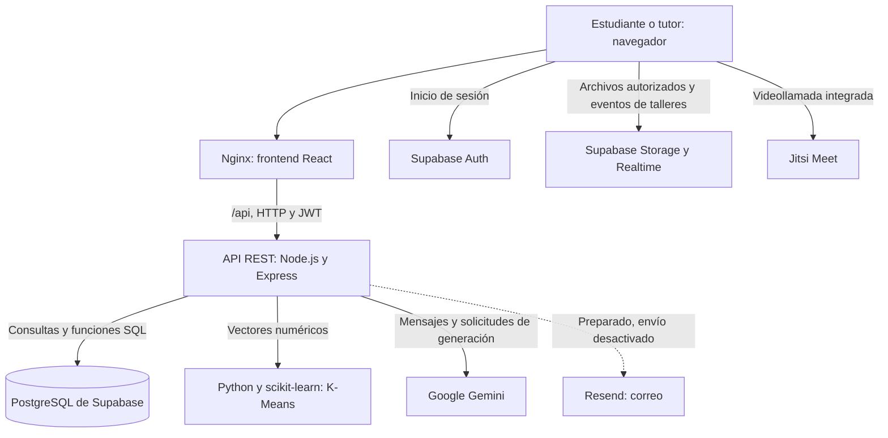

# InterAula: ficha técnica y funcional

Revisión del código y la configuración: **17 de noviembre de 2026**. Documento de apoyo para la demostración y defensa del proyecto. Describe la implementación del repositorio; los servicios externos y las revisiones humanas tienen sus propias condiciones operativas.

**1. Qué es y a quién sirve**

InterAula conecta organización del estudio, práctica, materiales, tutorías universitarias y proyectos colaborativos. Ofrece apoyos de lectura, comunicación y concentración opcionales, incluidos apoyos útiles para estudiantes con TEA, TDAH o dislexia. No exige diagnósticos para usarlos ni diagnostica a partir del comportamiento.

Una misma persona puede aprender y ofrecer tutorías en materias acreditadas. La acreditación académica, la formación inclusiva, las valoraciones y la trayectoria son dimensiones distintas.

**2. Arquitectura real**

La interfaz y la API están separadas. En Docker hay **tres servicios propios**: frontend/Nginx, backend/Node y ML/Python. Supabase sigue en la nube; Docker Compose no levanta una copia local de esa base ni ejecuta automáticamente sus migraciones. Gemini, el proveedor de videollamada y el correo también son dependencias externas.

El backend organiza cada dominio en rutas, controladores, esquemas de validación y servicios. PostgreSQL conserva reglas críticas mediante restricciones, funciones, transacciones, triggers y políticas de acceso. Algunas funciones privilegiadas usan un cliente de servidor con comprobaciones explícitas de identidad y permisos; las consultas ordinarias conservan el JWT del usuario y RLS.

**3. Tecnologías y para qué se usan**

Las familias de versiones indicadas corresponden a los manifiestos y Dockerfiles revisados; los archivos lock fijan las versiones resueltas.

| Tecnología | Dónde se utiliza | Propósito concreto |
| --- | --- | --- |
| React 19 y React DOM | Frontend | Componentes, formularios, paneles y actualización de la interfaz. |
| TypeScript | Frontend y backend | Tipos y contratos para perfiles, sesiones, proyectos y respuestas. Complementa las comprobaciones en ejecución. |
| Vite 8 y plugin React | Frontend | Servidor de desarrollo, actualización durante cambios y construcción del sitio para producción. |
| React Router 7 | Frontend | Rutas, navegación, páginas privadas y carga diferida de vistas. |
| CSS propio, HTML y SVG | Frontend | Diseño adaptable, temas, Modo Calma, controles e iconos. |
| React Context y hooks | Frontend | Estado de autenticación, preferencias visuales, orientador y comportamiento de vistas. |
| Node.js 22 | Contenedor backend y construcción | Ejecuta la API y las herramientas JavaScript/TypeScript. |
| Express 4 | Backend | API REST modular bajo `/api`. |
| Zod 3 | Backend | Valida cuerpos, parámetros y respuestas estructuradas; rechaza campos no permitidos en los esquemas estrictos. |
| Helmet y CORS | Backend | Cabeceras de seguridad y control de orígenes permitidos. No sustituyen la autenticación. |
| dotenv | Backend | Carga configuración privada desde variables de entorno. |
| Supabase JS | Ambas capas | Acceso a Auth, datos, Storage y funcionalidades autorizadas de Supabase. |
| Supabase Auth | Identidad | Registro, ingreso, recuperación de contraseña y flujo de Google OAuth sujeto a configuración del proveedor. |
| JWT | Autenticación de API | Transporta la sesión; el servidor verifica al usuario antes de aceptar acciones protegidas. |
| PostgreSQL, SQL y PL/pgSQL | Supabase | Persistencia relacional, funciones de negocio, validación transaccional y auditoría de decisiones. |
| Row Level Security, RLS | Base de datos | Restringe qué filas puede consultar o modificar cada identidad. |
| Supabase Storage | Archivos | Materiales, certificados y evidencias con controles por propietario/revisor y enlaces temporales cuando corresponde. |
| Supabase Realtime | Talleres | Eventos broadcast para refrescar cambios de talleres e inscripciones. No implica que todos los módulos sean en tiempo real. |
| Python 3.13 | Servicio ML interno | Ejecuta los modelos de agrupamiento sin recibir claves de Google o Supabase. |
| scikit-learn 1.7.1 | ML | KMeans, normalización/estandarización y evaluación silhouette. |
| NumPy y SciPy | ML | Representación matricial y soporte numérico; SciPy forma parte de la pila de scikit-learn. |
| threadpoolctl, joblib | Dependencias ML | Control de hilos y soporte de ejecución de la biblioteca. Este proyecto no guarda modelos pickle ni usa joblib como repositorio de modelos. |
| HTTP de la biblioteca estándar de Python | Servicio ML | Expone `/health`, `/cluster` y `/interests` dentro de la red interna. |
| Google Gemini, API REST | Backend | Orientador conversacional, explicaciones y otras generaciones educativas, incluidas preguntas de acreditación cuando está configurado. El modelo se selecciona con `GEMINI_MODEL`. |
| Jitsi Meet, External API | Aula virtual | Videollamada integrada, acceso a audio/vídeo y eventos de sala. Dominio configurable; respaldo por defecto `meet.jit.si`. |
| Web Speech API | Navegador | Lectura en voz alta y dictado en controles compatibles; depende de navegador, voces, permisos y servicio de reconocimiento disponible. |
| DOMPurify y sanitize-html | Frontend/backend | Saneamiento del contenido enriquecido en los flujos que lo procesan. |
| PDF.js | Frontend | Lectura y extracción de contenido de PDF. |
| Utilidades propias de exportación | Frontend | PDF, Markdown, texto, documento Word compatible y formato InterAula; también informe de progreso. |
| Docker y Docker Compose | Ejecución | Construcción, red, configuración y salud de frontend, backend y ML. |
| Nginx 1.27 | Contenedor frontend | Sirve archivos construidos, permite rutas SPA, comprime y dirige `/api` al backend. |
| Resend, API REST | Backend, preparado | Entrega futura de correos de clases. Requiere configurar remitente/proveedor y habilitar el envío. |
| npm, pip y archivos lock/requisitos | Desarrollo/construcción | Instalación de dependencias JavaScript y Python. |
| Git | Repositorio | Historial y control de cambios. No debe almacenar claves privadas o contraseñas DEMO. |
| Node test runner, tsx, Supertest, PGlite | Pruebas | Pruebas de lógica, HTTP y migraciones/funciones SQL en PostgreSQL temporal. |
| unittest de Python y Oxlint | Calidad | Pruebas de los modelos y revisión estática del código, respectivamente. |

**4. Funcionalidades y tecnología que las sostiene**

| Área | Qué permite hacer | Implementación principal y finalidad |
| --- | --- | --- |
| Acceso y sesión | Registro, ingreso, recuperación, salida y acceso privado | Supabase Auth, JWT, React Context, rutas protegidas y middleware de API. Vincula las acciones con una identidad. |
| Perfil universitario | Institución, carrera, habilidades, materias necesarias, disponibilidad y perfil público | React, API, catálogo académico y tablas relacionales. Conecta estudiantes con necesidades y ofertas pertinentes. |
| Navegación | Inicio explicativo, cuatro áreas, buscador global con Ctrl+K y enlaces a opciones | React Router y catálogo de navegación. El buscador encuentra módulos/opciones; no es una búsqueda semántica de todos los documentos. |
| Intereses y Para ti | Elegir lo que interesa, se quiere aprender o compartir; activar personalización, ocultar/restaurar sugerencias | API de recomendaciones, catálogo de temas, afinidad y agrupamiento opcional. La publicación de intereses requiere elección del usuario. |
| Comunidad académica | Elegir alcance por institución/sede/comuna y modalidad | Preferencias y reglas de ordenación. Prioriza coincidencias pertinentes sin GPS ni dirección residencial. |
| Rutas de estudio | Definir objetivo, etapas y avance | React, API learning-space y PostgreSQL. Conserva un camino de estudio que puede retomarse. |
| Organización | Tareas, subtareas, prioridades, temporizador, pausas e ideas rápidas convertibles a tareas | Estado de interfaz y persistencia por cuenta; generación de desglose con IA donde está disponible. Divide objetivos grandes en acciones manejables. |
| Explicaciones | Sencilla, paso a paso, ejemplos, visual y profunda; opciones de lenguaje literal y lectura | Servicio de aprendizaje, Gemini y presentación visual propia. Los respaldos deben identificarse cuando se usan. |
| Comprobar comprensión | Actividades, quizzes y registro de comprensión | Banco/lógica de actividades y servicios de IA según flujo. No debe confundirse todo quiz adaptado con el modelo BKT. |
| Práctica adaptativa | Objetivo, mapa de conceptos, ejercicios, pistas, retroalimentación y siguiente recomendación | BKT propio en TypeScript, grafo de prerrequisitos y funciones SQL. Piloto limitado de Cálculo. |
| Orientador | Conversar sobre InterAula y estudios; sugerir un recorrido pertinente | Gemini desde backend, historial corto, Zod y catálogo cerrado de guías. Conversar no publica, reserva ni acredita automáticamente. |
| Tutorial contextual | Resaltar controles, oscurecer entorno, explicar junto al elemento, pausar y escuchar | React, posicionamiento de overlay y Web Speech. Solo se activa cuando la persona elige una guía. |
| Apoyos opcionales | Modo Calma, contraste/tema, lectura, movimiento reducido, lenguaje literal y preferencias compartidas selectivamente | CSS, contextos, preferencias de cuenta y controles nativos. Facilita el uso sin clasificar personas por diagnóstico. |
| Tutorías individuales | Buscar, filtrar, solicitar, aceptar, preparar, cancelar y revisar agenda/historial | API tutoring, PostgreSQL y reglas de acreditación, disponibilidad, solapamiento y participantes. |
| Recomendación de tutores | Comparar preferencias de comunicación, dominio y puntualidad | Segundo pipeline K-Means sobre valoraciones agregadas, con catálogo de respaldo si no hay estructura suficiente. |
| Talleres grupales | Crear, gestionar cupos, inscribir/retirar participación y consultar agenda | API workshops, SQL y eventos Realtime. Las restricciones y cupos no dependen solo del botón visible. |
| Aula virtual | Previsualización, guion de sesión, cámara opcional y videollamada | React y Jitsi; registro de asistencia mediante heartbeats del servidor. La conexión multimedia requiere una prueba específica de red/permisos. |
| Acreditación académica | Evaluación técnica o respaldo documental/docente sujeto a revisión | Preguntas y soluciones protegidas en servidor, cronómetro, controles de integridad y proceso de validación. Solo materias verificadas quedan habilitadas. |
| Formación inclusiva | Presentar formación, emisor, certificado privado y caso práctico | Storage privado, funciones SQL y revisión autorizada con rúbrica. Se mantiene pendiente sin revisor designado. |
| Reputación | Confirmar realización, valorar comunicación/dominio/puntualidad y consultar trayectoria/calidad | Funciones SQL, reseña única por sesión y servicio de reputación. Separa cantidad de sesiones de calidad reciente. |
| Apuntes y materiales | Crear, editar, compartir, guardar privados/borradores, subir PDF y exportar | Editor React, saneamiento, API notes, Storage, PDF.js y exportadores propios. |
| Foro | Preguntas, discusiones, respuestas y votos | API forum, SQL, permisos de autoría y dictado opcional. |
| Proyectos | Publicar idea, vacantes, postulaciones, equipo y entregables | API projects y tablas relacionadas. La persona propietaria gestiona las incorporaciones. |
| Avisos | Bandeja interna, cambios de tutorías/talleres y recordatorios | Eventos transaccionales SQL y tarea periódica del backend. El correo es un canal adicional preparado. |
| Incidencias y convivencia | Reportar, consultar seguimiento, revisión, medidas y apelación | API support/moderation, funciones SQL, permisos específicos y trazabilidad. Una denuncia sola no sanciona. |
| Demo y ensayo | Cuentas ficticias, escenarios entre roles, reinicio acotado y retirada | Scripts TypeScript, SQL y guía local. Los datos DEMO no demuestran calidad académica real. |

**5. Los tres mecanismos inteligentes**

**K-Means de intereses:** representa cada perfil público elegible con un vector binario: 1 si tiene un tema público, 0 si no. Normaliza los vectores, prueba de 2 a 4 grupos y compara silhouette. Requiere al menos seis perfiles, variedad suficiente, grupos de al menos dos elementos y silhouette mínima de 0,15. Son criterios iniciales del prototipo, no evidencia de eficacia educativa. El backend combina el resultado con afinidad e institución/sede/comuna. El servicio ML recibe matrices, no nombres, correos, archivos o diagnósticos.

**K-Means de tutores:** recibe tres promedios: comunicación, dominio y puntualidad. El backend exige al menos tres reseñas por tutor para esta comparación y seis tutores elegibles para agrupar. Estandariza dimensiones, busca estructura y ordena según la prioridad elegida. El número del grupo no expresa un nivel de calidad. Si los datos son insuficientes, homogéneos o poco estructurados, se usa el respaldo del catálogo. Ninguno de estos agrupamientos concede acreditaciones o sanciona.

**BKT y grafo de conocimientos:** el grafo representa qué concepto necesita a cuál como prerrequisito. BKT actualiza una probabilidad de dominio con respuestas sin pista y considera parámetros de aprendizaje, adivinación y error accidental. El piloto usa probabilidad inicial 0,20, aprendizaje 0,10, adivinación 0,25 y error 0,10. Para consolidar exige probabilidad estimada de al menos 0,85 y tres ejercicios distintos correctos sin pista. Una pista no incrementa artificialmente ese dominio. Tras una dificultad, el selector puede recomendar reforzar un prerrequisito. Son **10 conceptos y 40 ejercicios de Cálculo**, con parámetros iniciales pendientes de validación educativa. La probabilidad no equivale a una nota ni a un diagnóstico.

**Gemini:** es el modelo generativo externo. El orientador recibe como máximo ocho mensajes recientes y el contexto de navegación validado. El servidor limita solicitudes, tiempo y formato de respuesta; ofrece guías de un catálogo autorizado. La lectura en voz alta la realiza la Web Speech API, no Gemini. El sistema no incorpora una base vectorial/RAG de todos los materiales; que el chat conozca la navegación no significa que haya leído todos los documentos o datos de una cuenta.

**6. Acreditación e integridad**

Los intentos nuevos de evaluación técnica terminan con el primer error, omisión o vencimiento: exigen 100% para aprobar. Los intentos antiguos mantienen su versión de política. Hay 20 segundos para alternativas y 40 para desarrollo breve; el modo extendido duplica los plazos. La generación actual con Google produce alternativas breves; el formato abierto depende del banco disponible. Entre respuestas correctas hay pausa mínima de 5 segundos, o 10 en modo extendido. Hay hasta tres inicios por usuario y hora.

Los plazos y las soluciones se gestionan en servidor. Se exige pantalla completa y se registran salidas de foco/pestaña e intentos de copiar/pegar; tres incidencias contabilizadas terminan el intento. Se intenta evitar repetir preguntas recientes mediante comparación textual y nueva generación. Esto reduce repeticiones; no garantiza detectar toda paráfrasis ni impide capturas del sistema operativo, cámaras externas o ayuda externa. El navegador no ofrece un bloqueo absoluto de copia.

La acreditación inclusiva es diferente: PDF privado, comprobación de formato/propiedad, emisor y caso práctico. La autenticidad y suficiencia requieren validación humana distinta del solicitante. Su sello reconoce el proceso interno de la plataforma; no es una licencia clínica o certificación profesional oficial.

**7. Insignias, calidad y malas experiencias**

- **Trayectoria:** hitos por 1, 10, 25 y 50 sesiones válidas; se preserva el historial anterior.
- **Sesión válida:** asistencia suficiente registrada y confirmación del tutor, o confirmación de ambos participantes. La confirmación conjunta es una declaración, no prueba independiente contra acuerdos fraudulentos.
- **Calidad reciente:** últimos 90 días, al menos 10 reseñas y 5 estudiantes distintos; reconocimiento por criterio si el promedio ajustado alcanza 8,5/10. Ajustado = `(suma de notas + 35) / (cantidad de reseñas + 5)`; suaviza muestras pequeñas sin inventar reseñas. El promedio real se muestra por separado.
- **Nota baja o reporte:** no elimina acreditaciones ni suma automáticamente un strike.
- **Hechos leves distintos confirmados en 90 días:** primero advertencia; segundo 7 días sin ofrecer tutorías/talleres; tercero o siguientes 30 días. Los hechos graves y las medidas preventivas requieren decisión explícita de un revisor con permisos adecuados.
- **Apelación:** revisión independiente; una revocación retira la medida y permite recalcular consecuencias dependientes. No se borra el historial.

**8. Seguridad, privacidad y operación**

Validación de identidad y permisos, titularidad de recursos, RLS, esquemas estrictos, saneamiento de contenido, Storage privado y enlaces temporales cuando corresponde. Las claves privadas se guardan solo en configuración de servidor. El ML está en la red interna Docker, con usuario sin privilegios y sin credenciales de otros proveedores. Los centroides/resultados usan caché temporal de memoria; no hay entrenamiento de diagnósticos.

Los avisos de clases usan cola persistida en PostgreSQL y un trabajador dentro del backend que revisa periódicamente, con reservas temporales de trabajo, reintentos e idempotencia. No hay un servicio RabbitMQ o Redis en el Compose actual. La cola y bandeja interna están implementadas; Resend permanece desactivado y las cuentas de esta presentación están excluidas del correo real.

**9. Estado y límites para la presentación**

- Tres contenedores configurados; datos y acceso principal en Supabase cloud.
- Revisión DEMO registrada: 26 comprobaciones reales de API, pantallas de estudiante/tutor/propietaria y previsualización de aula; 149 pruebas de backend aprobadas en la última evidencia de preparación. No se ejecutó de nuevo esa suite al escribir esta ficha.
- La IA respondió durante la preparación. La disponibilidad futura depende de conexión y cuota del proveedor.
- El catálogo incluye un flujo de Google OAuth, pero debe configurarse y comprobarse con su proveedor antes de presentarlo como probado.
- Correo real pendiente de proveedor/remitente; revisores y validadores reales pendientes de designar.
- La videollamada completa con dos participantes requiere ensayo de cámara, audio y red; haber visto la previsualización no valida esa comunicación.
- No se presenta la app como certificada en accesibilidad ni como intervención clínica validada.
- Hay componentes antiguos, como `LearningHub` y sus flashcards, que no están conectados al router actual. Su presencia en el repositorio no los convierte en módulos disponibles en la navegación vigente.

**10. Archivos que respaldan esta ficha**

- `frontend/package.json`, `backend/package.json`, `ml/requirements.txt`: dependencias.
- `docker-compose.yml`, los tres Dockerfiles y `frontend/nginx.conf`: ejecución y conexiones.
- `frontend/src/router/AppRouter.tsx`: páginas activas; `backend/src/routes/index.ts`: dominios API.
- `backend/src/services/orientationChat.service.ts`: alcance y contrato de Gemini.
- `ml/interests.py`, `ml/engine.py`: modelos K-Means.
- `backend/src/services/adaptiveEngine.ts`: BKT y selección de prerrequisitos.
- `backend/src/services/assessment.service.ts`: evaluación y cronómetros.
- `backend/src/services/reputation.service.ts`, `supabase/migrations/026_valid_sessions_and_reputation.sql`: reputación.
- `supabase/migrations/023_verified_inclusive_evidence.sql`, `028_moderation_measures.sql`, `029_class_alerts_and_email.sql`: evidencia, convivencia y alertas.
- `docs/demo-2026-11-17/verification-summary.json`: alcance de verificación de la demo.

Una explicación breve para la defensa: **InterAula utiliza una interfaz React, una API Node/Express y PostgreSQL con controles por usuario; integra Gemini para orientación, K-Means para recomendaciones y BKT con un grafo de prerrequisitos para proponer el siguiente paso de estudio, conectándolo con materiales, tutores y equipos.** Su propuesta combina estas capacidades en un recorrido universitario con apoyos opcionales. La utilidad educativa debe evaluarse con estudiantes; los datos ficticios verifican funcionamiento.
